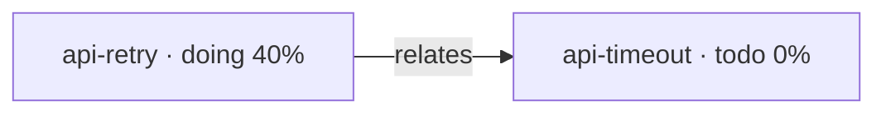

# 记忆文件格式

## 任务文件 `MEMORY_<task-id>.md`

YAML frontmatter + 自由正文。frontmatter 由工具解析，正文原样保留。

````markdown
---
id: api-retry
title: 支付接口重试策略
status: doing
progress: 0.4
updated: 2026-10-15T06:31:00.000Z
tags: [backend, reliability]
summary: 已定指数退避，待补熔断
---

## 背景
网关偶发 502，当前是固定 3 次重试。

## 决策
- 改为指数退避 + 抖动，上限 30s（2026-10-15 定）
- 幂等键走 `X-Request-Id`，避免重试产生重复扣款

## 下一步
- [ ] 补熔断阈值
````

### 字段

| 字段 | 必填 | 类型 | 说明 |
|---|---|---|---|
| `id` | 是 | string | 必须与文件名中的 `<task-id>` 一致 |
| `title` | 是 | string | 人类可读标题，进索引表 |
| `status` | 是 | enum | `todo` / `doing` / `blocked` / `done`，缺省或非法值按 `todo` |
| `progress` | 是 | number | `0`–`1`；写入时按两位小数保存 |
| `updated` | 是 | ISO 8601 | 每次改动刷新；由工具写，不要手填 |
| `tags` | 否 | inline array | `[a, b]` 形式，逗号分隔 |
| `summary` | 否 | string | **一句话状态**，进索引表；长内容放正文 |

解析是逐行的 `key: value`。未知字段会被忽略（不报错），所以不要指望用自定义字段存数据——**要存的东西写正文**。

### 正文怎么写

正文是给"下一次做这个任务的自己"看的。值得写的：决策与理由、约束、踩过的坑、当前卡点、下一步。不值得写的：代码里已经能读到的东西、临时寒暄、随口一说的进度。

单文件正文软上限 **16000 字符**。超过时 `check` 会提示"该拆了"——正确反应是拆成子任务并用 `child` 关联，而不是把内容挪到别处或删减。

## 索引 `MEMORY.md`

**由 `index` 命令整体重写，不要手改。** 三段结构：

````markdown
# 记忆索引

> 本文件只做索引与关系图谱；任务内容在 `MEMORY_<任务ID>.md`，原始日志在 `YYYY-MM-DD.md`。

## 任务

| ID | 标题 | 状态 | 进度 | 更新 |
|----|------|------|------|------|
| api-retry | 支付接口重试策略 | doing | 40% | 2026-10-15 |

## 关系图谱



## 机器可读的关系块（由工具生成，勿手改）

```edges
api-retry relates api-timeout
```
````

- 任务表与 mermaid 都是**渲染结果**，按 id 字典序排列，因此同样的输入总产出同样的文本（这是故意的：稳定的文本才能被前缀缓存命中）。
- `edges` 块是**关系唯一的机器可读来源**，语法为每行 `<from> <kind> <to>`。
- 想加关系请用 `link` 命令。手改 `edges` 块后必须再跑一次 `index`，否则任务表与 mermaid 会和它不一致。

## 任务 id 规则

必须匹配 `^[A-Za-z0-9][A-Za-z0-9._-]*$`，且不得包含 `..`。

即：字母或数字开头，只含字母、数字、`.`、`_`、`-`。用 kebab-case 描述一个话题，例如 `api-retry`、`kvmem-design`、`lmmarr-publish`。

不合法的文件名不会被加载（防止一个手写的怪名字让整条记忆链崩掉），但也不会静默消失——`check` 会把它报出来。

## 日期日志 `YYYY-MM-DD.md`

按天的原始流水，**只追加**。格式自由，但一条记录写清"做了什么、结论是什么"比写"做了很多事"有用。工具不读也不写它，它的价值在于保留了判断发生时的语境。

## 进度与状态的写法建议

- `progress` 是**主观完成度**，不是精确计量。0.1 的粒度足够，别假装精确。
- `doing` 但进展停滞的任务，考虑标 `blocked` 并在正文写清卡在哪——这比留一个不动的 `doing` 有用得多。
- 任务真正完成后标 `done`，并在正文留下"结论"而非"过程"。
